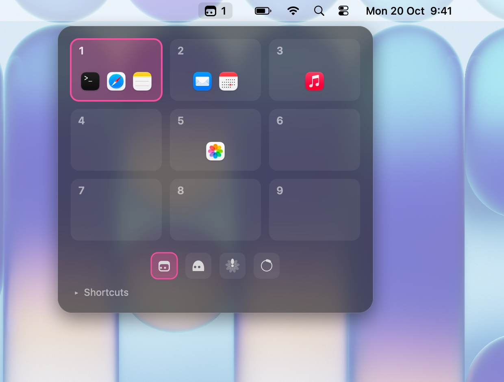
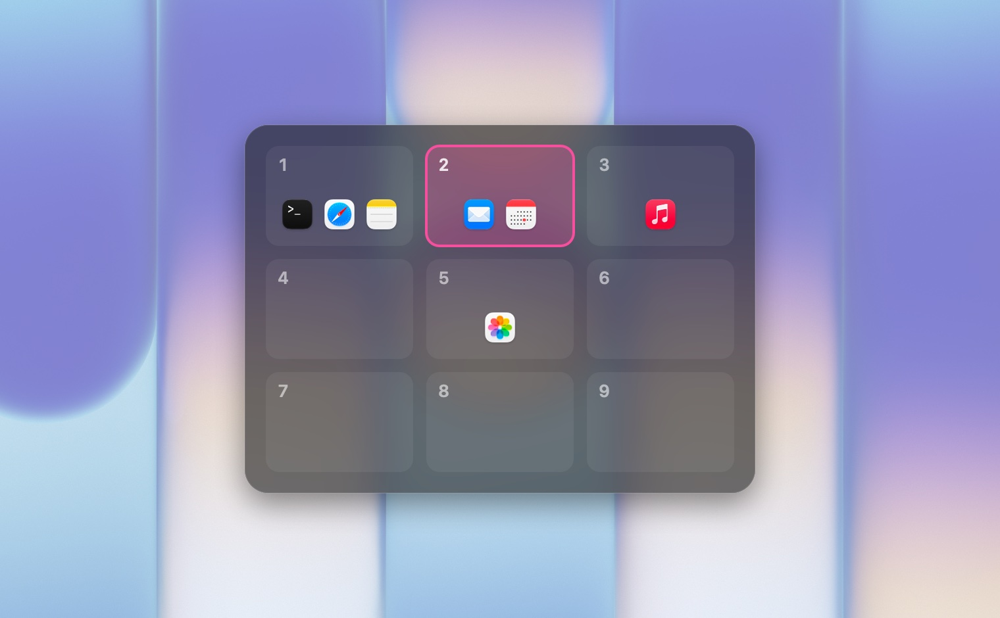

<h1 align="center">wrkspaces</h1>
<p align="center">Des bureaux virtuels pour macOS. Pas de tiling, pas d'animation, rien à apprendre.</p>
<p align="center"><sub>v0.1.5 · Swift · macOS · MIT</sub></p>
<p align="center"><a href="#fonctionnalités">Fonctionnalités</a> · <a href="#installation">Installation</a> · <a href="#utilisation">Utilisation</a> · <a href="#développement">Développement</a> · <a href="README.md">English</a></p>

<p align="center">
  
</p>

## Fonctionnalités

- **Changement instantané** : neuf bureaux, aucune animation, pas de SIP à désactiver.
- **Raccourcis déjà connus** : les mêmes que les Spaces de macOS.
- **Vous suit** : Cmd-Tab ou le Dock vers une fenêtre d'un autre bureau vous y emmène.
- **Rien de perdu** : quitter, Ctrl-C ou un plantage remet chaque fenêtre à l'écran.
- **Aucune config** : une icône dans la barre de menus avec le numéro du bureau courant et un petit dessin : une fenêtre avec des yeux, un blob, une fleur dont la pétale en surbrillance est le bureau, ou un anneau. Il se choisit sous la grille que l'icône ouvre.
- **Voir où est tout** : un clic sur l'icône ouvre une grille des neuf bureaux avec leurs apps, un clic sur un bureau vous y emmène. Gardez `⌃` enfoncé après `⌃N` et la même grille apparaît, comme Cmd-Tab. Une liste dépliable sous la grille rappelle tous les raccourcis. Clic droit sur l'icône pour quitter.

## Installation

Téléchargez `wrkspaces-macos-universal.dmg` depuis la [dernière release](https://github.com/te-o-o-o/wrkspaces/releases/latest), ouvrez-le et glissez `wrkspaces.app` sur Applications (un `.zip` de la même app est aussi disponible). Il tourne sur les Mac Apple Silicon et Intel, macOS 14 ou plus récent.

L'app n'est pas signée avec un identifiant développeur Apple, donc macOS la bloque au premier lancement : clic droit dessus puis **Ouvrir**, ou lancez une fois `xattr -d com.apple.quarantine /Applications/wrkspaces.app`.

Depuis les sources (outils en ligne de commande Xcode requis) :

```sh
git clone https://github.com/te-o-o-o/wrkspaces && cd wrkspaces
./bundle.sh
cp -R .build/wrkspaces.app /Applications/
open /Applications/wrkspaces.app
```

Au premier lancement, macOS demande l'accès Accessibilité : accordez-le et l'app démarre d'elle-même. Clic droit sur l'icône puis **Open at Login** pour la lancer avec la session.

Après une recompilation, macOS ne reconnaît plus l'app : retirez-la de la liste Accessibilité (ou lancez `tccutil reset Accessibility io.github.te-o-o-o.wrkspaces`) et accordez l'accès à nouveau.

## Utilisation

| Raccourci | Action |
|---|---|
| `⌃1` … `⌃9` | aller au bureau N |
| `⌃⇧1` … `⌃⇧9` | envoyer la fenêtre active au bureau N |
| `⌃` ou `⌃⇧` + pavé `1` … `9` | pareil, depuis le pavé numérique |

<p align="center"></p>

Si les raccourcis natifs « Passer au bureau N » sont activés, désactivez-les : Réglages Système > Clavier > Raccourcis clavier > Mission Control.

**Pas encore** : un seul jeu de bureaux pour tous les écrans, pas de bureaux par écran.

## Développement

```sh
swift test
swift run wrkspaces
```

Principe : les fenêtres des autres bureaux sont garées dans le coin en bas à droite de l'écran, comme le fait AeroSpace. Décisions et pièges dans [docs/notes.fr.md](docs/notes.fr.md).

## Licence

[MIT](LICENSE)
